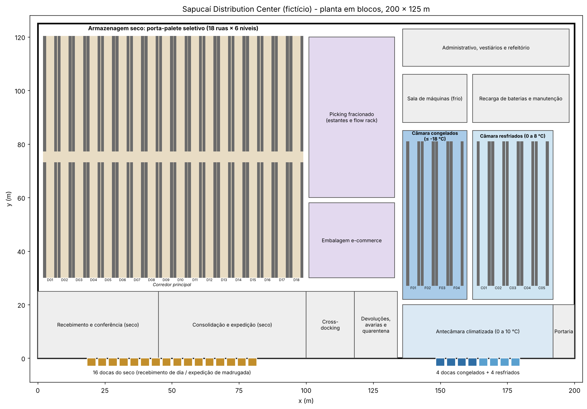
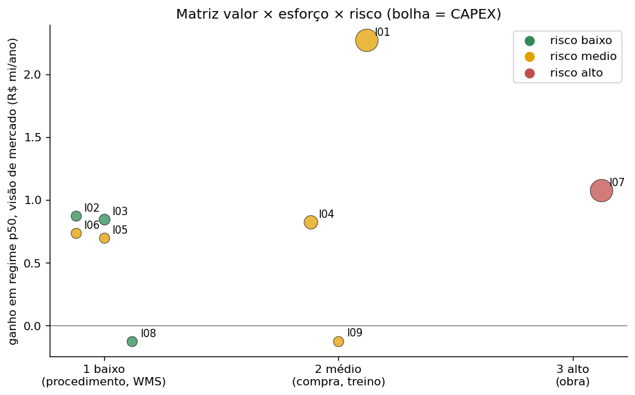

# Multi-Temperature Distribution Center — Simulation & Optimization

🇧🇷 [Versão em português](README.pt-BR.md)

A supply chain portfolio project, written up as a business case: a simplified **digital twin** of a large
multi-temperature (dry, chilled, frozen) food distribution center. It generates 24 months of simulated
operations, diagnoses the problems with data and builds a **cost reduction program** with measured,
de-duplicated savings.

> **Disclaimer:** *Sapucaí Distribution Center (SDC)* is a **fictional** company. All data is **synthetic**
> (generated by code) and all parameters are order-of-magnitude estimates. See
> [`docs/assumptions.md`](docs/assumptions.md). Any resemblance to real companies is coincidental.

**Start here:** [executive report](reports/executive_report.md) (one page, Portuguese with an English summary) ·
[interactive dashboard](https://mazeik.github.io/multi-temperature-dc-simulation/dashboard/)
(or open [`docs/dashboard/index.html`](docs/dashboard/index.html) locally) ·
[study guide](docs/guia_do_projeto.md) (Portuguese, plain language)

## In plain words (for recruiters and non-specialists)

A **distribution center (DC)** is the warehouse where a company receives goods from suppliers, stores
them and builds orders for stores and online customers. This one is **made up**: a food DC with dry,
chilled and frozen areas.

- **What was done:** a program created two years of realistic but fake operations (trucks, orders,
  stock, losses) with **12 hidden problems**, such as products running out, late suppliers and food
  spoiling on the dock outside the cold room.
- **Who did what:** the project was built with the help of **Claude, an AI assistant by Anthropic**.
  Claude wrote the data generator and **planted the problems**. The analysis was then done **without
  opening the generator or the answer key**, as if it were a real company's data, and was checked against
  the key only at the end: all 12 problems were found. I set the scope, made the decisions, reviewed the
  results and used the project to learn the tools.
- **Main finding:** the biggest cost is not labor but **food lost in the cold chain**. A cheap fix
  (sealing and air curtains on the cold docks, plus a standard procedure) leads the program. Better working
  methods save millions per year without hiring.
- **Tools:** Python, SQL, mathematical optimization, simulation, Power BI and quality tools (Pareto, FMEA, SOPs).

## 1. The situation

SDC serves ~1,500 stores (B2B) and e-commerce customers from a ~25,000 m² facility with 18,144 pallet
positions, ~6,000 SKUs and 24 docks. FEFO and shelf-life control, lot traceability and recall, cold-chain dock
exposure limits, pallet/case/unit picking and strong seasonality make it hard to run.

| Indicator (base year Nov/2025–Oct/2026) | Today | Usual target |
|---|---|---|
| OTIF (complete and on time) | **52%** (B2B 21%) | ≥ 90% |
| Fill rate (units) | 92.6% | ≥ 97% |
| Inventory accuracy | 96% | ≥ 98.5% |
| Cold-chain loss | 4.1% of cold revenue | ~1% in a mature operation (estimate) |
| December orders picked on the planned night | 17% | ≥ 90% |
| DC cost | R$ 96.7M/yr (3.5% of goods handled) | — |



## 2. What the data showed

1. **Service is an inventory problem, not a transport one.** The reorder point was fixed in days per zone,
   blind to each supplier's lead time (correlation 0.09). A B2B order has ~32 lines, so one missing line breaks it.
2. **Cost is cold-chain product loss, not labor.** 27% of chilled and 63% of frozen pallets exceed the
   maximum dock time. One point of cold loss is worth more than all picking optimization.
3. **Picking is at its limit in the peak.** Christmas +40% without preparation creates an 8-day order queue.
   Re-slotting fixes most of it without hiring.
4. **A few suppliers drive losses.** Two accept lots below 70% shelf life (72% of expired units), three are
   chronically late and one caused both recalls.
5. **Small e-commerce orders do not pay their way.** Under R$ 25 (1 order in 4), margin only breaks even
   with picking and packing cost.

## 3. The program (12 months)

The phase-by-phase savings register adds up to R$ 23.3M/yr, but it mixes data scales and counts slotting
four times. After de-duplication, with cold losses adjusted to a market level (the conservative view) and a
10,000-draw Monte Carlo on the uncertain assumptions:

| Wave | What changes | Run-rate p50 (R$ M/yr) | Capex (R$ M) |
|---|---|---|---|
| **1 · 0–3 months** | Cold-dock kit + receiving SOP, dock scheduling, slotting, shelf-life lock in the WMS, min-based replenishment, ABC cycle counting | 5.3 | 0.8 |
| **2 · 3–6 months** | E-commerce multi-order carts, per-SKU safety stock | 0.7 | 0.1 |
| **3 · 6–12 months** | One extra cold dock per chamber (conditional) | 1.1 | 0.8 |
| **Total** | | **7.1** (p10–p90: 6.2–8.1) | **1.7** |

**Year 1: R$ 5.1M (p50), payback in month 4.** Without the market adjustment it is R$ 15.5M/yr at
run-rate. The cold-dock kit drives most of the uncertainty, so the first step is a 2-dock pilot. Each
initiative has a tracking KPI with baseline, target and owner.



## 4. How it was done

| Phase | Question | Method | Write-up |
|---|---|---|---|
| 0–1 Foundation, layout | What does the DC look like? | Assumptions, zoning, addressing, U-flow | [assumptions](docs/assumptions.md) · [layout](docs/layout.md) · [processes](docs/processes.md) |
| 2 Data generator | How do we get realistic data? | 24-month synthetic operation with stock conservation checks and a "dirty legacy" export | [data model](docs/data_model.md) |
| 3 Database | How do we query it? | SQLite star schema and KPI queries | [schema](sql/01_schema.sql) · [KPIs](sql/02_kpis.sql) |
| 4 Diagnosis & inventory | Why is OTIF 52%? | Data quality, KPI deep-dive, ABC/XYZ, forecasting, safety stock, FEFO | [summary](reports/phase4_summary.md) · [Power BI model](powerbi/README.md) |
| 5 Slotting | Where should each SKU sit? | Assignment model (PuLP + HiGHS) vs simple rule | [summary](reports/phase5_summary.md) |
| 6 Simulation | What happens at Christmas +40%? | SimPy discrete-event model, validated and calibrated | [summary](reports/phase6_summary.md) |
| 7 Picking & labor | How many people per shift? | Batch picking, routing, 12-month staffing plan | [summary](reports/phase7_summary.md) |
| 8 Costs & scenarios | What does it cost and where to invest? | Activity-based costing, cost-to-serve, NPV, racking decision (S01) | [summary](reports/phase8_summary.md) |
| 9 Quality | Where do losses come from? | Pareto, fishbone, FMEA, recall traceability, cycle counting, [SOPs](docs/sops/) | [summary](reports/phase9_summary.md) |
| 10 Cost program | How much can we really save? | De-duplicated pipeline, Monte Carlo, value × effort × risk, roadmap, cost-to-serve by customer and SKU | [summary](reports/phase10_summary.md) |
| 11 Wrap-up | How do we present it? | Executive report and dashboard | [report](reports/executive_report.md) · [dashboard](docs/dashboard/index.html) |

## 5. Limitations

- Synthetic data: R$ values compare decisions, they are not a budget. Cost assumptions live in
  [`config/`](config/) and should be calibrated with real accounting.
- Cold-chain losses in the data are above market levels; the results show both views.
- Stores in the data have nearly identical profiles, so customer-level cost-to-serve varies little; with real
  data this is where expensive customers show up. Freight and taxes are out of scope.
- Most analyses run on a 10% data scale and are scaled up; each write-up states its scale.

## Run it

```bash
python -m venv .venv
# Windows: .venv\Scripts\activate   |   Linux/macOS: source .venv/bin/activate
pip install -r requirements.txt
python src/check_setup.py
python src/generate_data.py          # 10% scale, ~30 s -> data/raw/ (Parquet); --scale 1.0 = full size
python src/validate_data.py          # integrity + stock-conservation checks + KPI summary
python src/export_legacy.py          # optional: dirty legacy-style CSVs in data/legacy/ for cleaning practice
python src/build_db.py               # SQLite star schema (data/sdc.db)
python src/run_kpis.py               # KPI queries
python notebooks/build_notebooks.py  # all analysis notebooks (04a-10c) -> reports/ (06b takes ~30 min)
python src/export_powerbi.py         # Power BI tables -> powerbi/data/
python src/build_dashboard.py        # HTML dashboard -> docs/dashboard/index.html
```

Same seed + same scale = identical data. The generator is open source, so the answer key is technically
discoverable: for the exercise to be meaningful, analyze the data first and read the generator afterwards.

## Repository structure

```
├── config/          # parameters.yaml (facility), data_generation.yaml, cost_program.yaml (Phase 10)
├── docs/            # assumptions, layout, processes, scenarios, SOPs, study guide, dashboard/
├── src/             # data generator (dcsim), simulation (flowsim), helpers, dashboard builder
├── sql/             # schema and KPI queries
├── notebooks/       # analyses 04a-10c (edit notebooks/src/*.py, then rebuild)
├── powerbi/         # Power BI model, DAX measures and page guide
├── reports/         # phase summaries, executive report, tables and charts
└── data/            # generated locally, not versioned
```

## Tech stack

Python (pandas, NumPy, statsmodels, SimPy, PuLP) · SQL (SQLite) · Power BI (DAX) · HTML/SVG · Git

## Author

**John Wesley da Silva** — Production Engineer (Process Engineering postgraduate), process and quality
background, focused on supply chain and data analytics. Built with the help of Claude (Anthropic).
[LinkedIn](https://www.linkedin.com/in/john-wesley-da-silva/)
