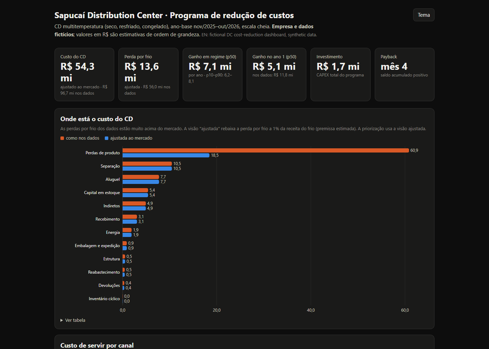

# CD multitemperatura: simulação e otimização

🇺🇸 [English version](README.md)

Minha experiência é em processos e qualidade. Eu queria entender, por dentro, como funciona a gestão de
um armazém, e fiz este projeto para isso. Montei um CD de alimentos fictício (seco, resfriado e
congelado) no Sul de Minas, gerei dois anos de operação sintética e tratei os dados como se fossem de
uma empresa real: descobrir o que está errado, medir quanto custa e decidir o que atacar primeiro.

A empresa (*Sapucaí Distribution Center*) e os dados são inventados. Os valores em R$ são estimativas
de ordem de grandeza: servem para comparar decisões, não como orçamento. Premissas em
[`docs/assumptions.md`](docs/assumptions.md).

Para ver o resultado rápido: [painel interativo](https://mazeik.github.io/multi-temperature-dc-simulation/dashboard/)
e [relatório executivo](reports/executive_report.md) (uma página).

[](https://mazeik.github.io/multi-temperature-dc-simulation/dashboard/)

## Como o CD está hoje

Ano-base nov/2025 a out/2026, ~1.500 lojas (B2B) e e-commerce, ~6.000 SKUs, 18.144 posições de palete
e 24 docas.

| Indicador | Hoje | Referência usual |
|---|---|---|
| OTIF (pedido completo e no prazo) | 52% (lojas: 21%) | 90% ou mais |
| Fill rate (unidades) | 92,6% | 97% ou mais |
| Acuracidade de inventário | 96% | 98,5% ou mais |
| Perda por frio | 4,1% da receita do frio | ~1% (estimativa) |
| Pedidos de dezembro separados na noite prevista | 17% | 90% ou mais |
| Custo do CD | R$ 96,7 mi/ano | |

## O que encontrei

1. **Metade dos pedidos sai incompleta ou atrasada.** O ponto de pedido era o mesmo número de dias para
   todos os produtos de uma zona, sem considerar o prazo de cada fornecedor (correlação de 0,09 entre
   os dois). Um pedido de loja tem ~32 itens, então basta faltar um para ele sair incompleto.
2. **Palete frio espera demais na doca.** 27% dos resfriados e 63% dos congelados passam do tempo
   máximo. É a maior perda de dinheiro do CD. O gerador exagerou essa perda (4% da receita do frio),
   por isso todos os números do plano usam também uma versão ajustada a ~1%, mais perto do mercado.
3. **No Natal a separação não dá conta.** Sem preparo, um pico de +40% gera uma fila de ~8 dias.
   Colocar os itens mais visitados nas posições mais perto (slotting) resolve a maior parte sem
   contratar.
4. **Poucos fornecedores concentram o problema.** Dois entregam lotes com menos de 70% da validade
   (72% do que venceu veio deles), três atrasam quase sempre e um causou os dois recalls.
5. **Pedido pequeno de e-commerce dá prejuízo.** Abaixo de R$ 25 (1 em cada 4 pedidos), a margem mal
   cobre o custo de separar e embalar.

## O que eu faria primeiro

Um piloto barato em 2 docas frias (vedação, cortina de ar e um procedimento de recebimento), junto com
agendamento de docas e trava de validade no WMS. O plano completo tem três ondas em 12 meses:

| Onda | O que muda | Ganho estimado (R$ mi/ano) | Investimento (R$ mi) |
|---|---|---|---|
| 0 a 3 meses | Kit de doca fria e procedimento de recebimento, agendamento de docas, slotting, trava de validade no WMS, reabastecimento por mínimo, inventário cíclico | 5,3 | 0,8 |
| 3 a 6 meses | Carrinho multi-pedido no e-commerce, estoque de segurança por SKU | 0,7 | 0,1 |
| 6 a 12 meses | Mais uma doca fria por câmara, se o agendamento não bastar | 1,1 | 0,8 |
| Total | | perto de 7 | 1,7 |

No primeiro ano, o ganho estimado fica em torno de R$ 5 milhões e o investimento se paga por volta do
quarto mês. Quase toda a incerteza está no kit da doca fria, e é por isso que ele começa como piloto.
Faixas, premissas e sensibilidade estão no [resumo da Fase 10](reports/phase10_summary.md).

## Como trabalhei com a IA

Fiz o projeto em dupla com o Claude, uma IA da Anthropic. Ele escreveu a maior parte do código e me
ajudou na análise. Eu entrei com o olhar de processos e qualidade e com as decisões. Também foi o Claude
que escreveu o gerador de dados e escondeu 12 problemas nele. Por isso, a análise foi feita sem abrir o
gerador, e o gabarito só foi consultado no fim: 11 problemas apareceram na Fase 4 e o último na Fase 5.

Algumas decisões que foram minhas:

- **Não aceitar a perda de frio dos dados como verdade.** 4% da receita do frio é alto demais para um CD
  real. Pedi uma segunda visão ajustada ao mercado e é ela que define as prioridades.
- **Não somar os ganhos das fases.** A soma direta dava R$ 23,3 mi/ano, mas misturava escalas e contava
  o slotting em quatro fases. Pedi para consolidar sem dupla contagem, e o número caiu para ~R$ 7 mi.
- **Prometer resultado em 12 meses.** Um plano de um ano é mais fácil de cobrar. O VPL de 5 anos ficou
  só como referência.
- **Deixar a escolha da estrutura das câmaras para quem tem o orçamento.** Seletivo, drive-in ou
  estante móvel depende de preço real. Montei a comparação como uma decisão para a gerência, em vez de
  decidir com premissa.

A parte de qualidade (Pareto, Ishikawa, FMEA, procedimentos padrão e inventário cíclico) é a mais
próxima do que eu já fazia no trabalho.

## Linha do tempo

O projeto foi construído em **2 dias**, mas veio depois de meses de estudo e de projetos menores.

| Quando | O que aconteceu |
|---|---|
| Antes de ago/2026 | Experiência prática em processos, qualidade, PCP e logística |
| Ago/2026 | Comecei a estudar Python com IA, no curso da Data Science Academy |
| Set/2026 | Python, Git/GitHub e pandas, no curso do Téo Me Why |
| Out/2026 | Power BI, na Data Science Academy. Leitura de *Gestão da Cadeia de Suprimentos* (Chopra e Meindl), livro em que me baseio neste projeto |
| Nov/2026 | Primeiros projetos de análise no GitHub |
| 20 a 21/nov | Ideia do CD multitemperatura, escolha do cenário e aprovação do plano |
| **21 a 22/nov** | **Construção das fases 0 a 11 com o Claude**: eu defini as perguntas, as premissas e as decisões, e a IA escreveu a maior parte do código |
| A partir de 23/nov | Estudo fase a fase e reinvestigação dos dados sem consultar o gabarito, registrada em [`docs/diario_de_analise.md`](docs/diario_de_analise.md) |

A velocidade vem da IA. O que eu trago é saber **que perguntas fazer, o que desconfiar e o que decidir**.

## O que uma simulação não substitui

Num CD de verdade, eu não começaria pela planilha. Antes de abrir os dados, passaria alguns turnos na
doca fria e conversaria com quem recebe, confere e guarda: por que o palete fica 30 minutos parado? Falta
gente, falta espaço na antecâmara, os caminhões chegam todos juntos? Faria o mesmo com o pessoal da
separação antes do Natal. Os dados mostram onde dói. Quem trabalha ali sabe por quê.

Aqui não dá para fazer isso. Por isso, as causas que aponto são hipóteses que eu confirmaria no galpão
antes de gastar qualquer dinheiro.

Outras limitações:

- As lojas dos dados têm perfis quase iguais, então o custo de servir varia pouco entre clientes. Com
  dados reais, é nessa análise que aparecem os clientes caros. Frete e impostos ficam fora do escopo.
- A maior parte das análises roda com 10% do volume e é ampliada. Cada resumo informa a escala usada.
- As premissas de custo ficam em [`config/`](config/) e precisariam ser calibradas com a contabilidade
  real.

## Como foi feito

| Fase | Pergunta | Método | Detalhes |
|---|---|---|---|
| 0–1 Fundação e layout | Como é o CD? | Premissas, zoneamento, endereçamento, fluxo em U | [premissas](docs/assumptions.md), [layout](docs/layout.md), [processos](docs/processes.md) |
| 2 Gerador de dados | Como ter dados realistas? | Operação sintética de 24 meses, conferência de conservação do estoque e export "legado sujo" | [modelo de dados](docs/data_model.md) |
| 3 Banco de dados | Como consultar? | Modelo estrela em SQLite e consultas de KPI | [schema](sql/01_schema.sql), [KPIs](sql/02_kpis.sql) |
| 4 Diagnóstico e estoque | Por que o OTIF é 52%? | Qualidade dos dados, KPIs, ABC/XYZ, previsão, estoque de segurança, FEFO | [resumo](reports/phase4_summary.md), [modelo Power BI](powerbi/README.md) |
| 5 Slotting | Onde cada SKU deve ficar? | Modelo de alocação (PuLP + HiGHS) comparado com uma regra simples | [resumo](reports/phase5_summary.md) |
| 6 Simulação | O que acontece no Natal +40%? | Simulação de eventos discretos (SimPy), validada e calibrada | [resumo](reports/phase6_summary.md) |
| 7 Separação e mão de obra | Quantas pessoas por turno? | Separação em lote, roteirização, quadro de 12 meses | [resumo](reports/phase7_summary.md) |
| 8 Custos e cenários | Quanto custa e onde investir? | Custeio por atividade, custo de servir, VPL, decisão de estrutura das câmaras | [resumo](reports/phase8_summary.md) |
| 9 Qualidade | De onde vêm as perdas? | Pareto, Ishikawa, FMEA, rastreio de recall, inventário cíclico, [POPs](docs/sops/) | [resumo](reports/phase9_summary.md) |
| 10 Programa de custos | Quanto dá para economizar de verdade? | Consolidação sem dupla contagem, Monte Carlo, priorização, ondas, custo de servir por cliente e SKU | [resumo](reports/phase10_summary.md) |
| 11 Fechamento | Como apresentar? | Relatório executivo e painel | [relatório](reports/executive_report.md), [painel](docs/dashboard/index.html) |

## Como rodar

```bash
python -m venv .venv
# Windows: .venv\Scripts\activate   |   Linux/macOS: source .venv/bin/activate
pip install -r requirements.txt
python src/check_setup.py
python src/generate_data.py          # escala 10%, ~30 s -> data/raw/ (Parquet); --scale 1.0 = volume completo
python src/validate_data.py          # integridade + conservação de estoque + resumo de KPIs
python src/export_legacy.py          # opcional: CSVs "legado sujo" em data/legacy/ para treinar limpeza
python src/build_db.py               # modelo estrela em SQLite (data/sdc.db)
python src/run_kpis.py               # consultas de KPI
python notebooks/build_notebooks.py  # todos os notebooks (04a-10c) -> reports/ (o 06b leva ~30 min)
python src/export_powerbi.py         # tabelas do Power BI -> powerbi/data/
python src/build_dashboard.py        # painel HTML -> docs/dashboard/index.html
```

Mesma semente + mesma escala = dados idênticos. O gerador é aberto, então o gabarito é tecnicamente
descobrível: para o exercício valer, analise os dados primeiro e leia o gerador depois.

## Estrutura do repositório

```
├── config/          # parameters.yaml (CD), data_generation.yaml, cost_program.yaml (Fase 10)
├── docs/            # premissas, layout, processos, cenários, POPs, dashboard/
├── src/             # gerador (dcsim), simulação (flowsim), funções de apoio, gerador do painel
├── sql/             # schema e consultas de KPI
├── notebooks/       # análises 04a-10c (editar notebooks/src/*.py e regenerar)
├── powerbi/         # modelo Power BI, medidas DAX e roteiro das páginas
├── reports/         # resumos das fases, relatório executivo, tabelas e gráficos
└── data/            # gerado localmente, fora do Git
```

## Tecnologias

Python (pandas, NumPy, statsmodels, SimPy, PuLP), SQL (SQLite), Power BI (DAX), HTML/SVG e Git.

## Autor

**John Wesley da Silva**, engenheiro de produção, pós-graduado em Engenharia de Processos, com experiência
em processos e qualidade e migrando para supply chain e análise de dados.
[LinkedIn](https://www.linkedin.com/in/john-wesley-da-silva/)
