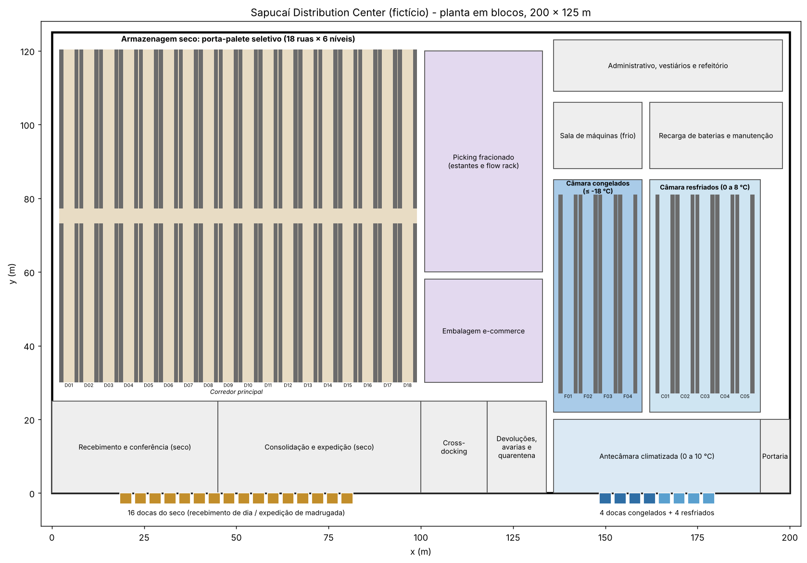

# CD Multitemperatura — Simulação e Otimização

🇺🇸 [English version](README.md)

Projeto de portfólio em supply chain: um **gêmeo digital** simplificado de um grande centro de distribuição multitemperatura (seco, resfriado e congelado) de bens de consumo. Gera 24 meses de operação simulada, diagnostica problemas operacionais com dados e propõe melhorias com ganho medido.

> **Aviso:** a *Sapucaí Distribution Center (SDC)* é uma empresa **fictícia**. Todos os dados são **sintéticos** (gerados por código) e os parâmetros são estimativas de ordem de grandeza. Veja [`docs/assumptions.md`](docs/assumptions.md). Qualquer semelhança com empresas reais é coincidência.

## O caso de negócio

A SDC atende ~1.500 lojas (B2B) e clientes de e-commerce a partir de um galpão de ~25.000 m², com 18.144 posições de palete, ~6.000 SKUs e 24 docas. As restrições reais deixam o problema difícil: FEFO e controle de validade, rastreabilidade de lote e recall, limite de exposição na doca (cadeia do frio), separação de palete/caixa/unidade e forte sazonalidade.

## Layout do galpão



Detalhes: [layout e endereçamento](docs/layout.md) · [fluxos de processo](docs/processes.md)

## Como rodar

```bash
pip install -r requirements.txt
python src/generate_data.py          # escala de 10%, ~30 s -> data/raw/ (Parquet)
python src/validate_data.py          # integridade + conservação de estoque + resumo de indicadores
python src/export_legacy.py          # opcional: CSVs "sujos" de sistema legado em data/legacy/ para treino de limpeza
```

Use `--scale 1.0` para o CD em tamanho completo (bem maior e mais lento). Mesma semente + mesma escala = dados idênticos.
Os dados têm problemas operacionais realistas que as próximas fases precisam **encontrar com dados**.
O gerador é aberto, então o gabarito é tecnicamente descobrível: para o exercício valer, analise os dados primeiro e leia o gerador depois.

## Roteiro

| Fase | Entrega | Status |
|---|---|---|
| 0. Fundação | Repositório, estrutura, premissas documentadas | Concluída |
| 1. Layout e processos | Zonas, endereçamento, fluxos | Concluída |
| 2. Gerador de dados | 24 meses de operação sintética com problemas ocultos, [modelo de dados](docs/data_model.md), exportação suja estilo sistema legado | Concluída |
| 3. Banco de dados | Modelo estrela em SQL e consultas de indicadores | Planejada |
| 4. Diagnóstico e estoque | Indicadores, ABC/XYZ, previsão, estoque de segurança, dashboard v1 | Planejada |
| 5. Slotting | Alocação otimizada de endereços | Planejada |
| 6. Simulação | Simulação de eventos discretos (SimPy) e cenários | Planejada |
| 7. Picking e mão de obra | Estratégias de separação, roteirização, dimensionamento | Planejada |
| 8. Custos e cenários | Custeio por atividade, retorno e [cenários de trade-off](docs/scenarios.md) para a gerência | Planejada |
| 9. Qualidade | FMEA, inventário cíclico, rastreio de recall, POPs | Planejada |
| 10. Fechamento | Relatório executivo e dashboard final | Planejada |

## Estrutura do repositório

```
├── docs/                  # premissas, layout, processos, decisões
├── config/parameters.yaml # parâmetros do CD (fonte única da verdade)
├── src/                   # gerador de dados, simulação, análises
├── sql/                   # schema e consultas de indicadores
├── notebooks/             # análises passo a passo
├── powerbi/               # dashboard (.pbix)
├── reports/               # relatórios e gráficos finais
└── data/                  # gerado localmente, fora do Git
```

## Como começar

```bash
python -m venv .venv
# Windows: .venv\Scripts\activate   |   Linux/macOS: source .venv/bin/activate
pip install -r requirements.txt
python src/check_setup.py
```

## Tecnologias

Python (pandas, NumPy, statsmodels, SimPy, PuLP) · SQL (SQLite) · Power BI (DAX) · Git

## Autor

**John Wesley da Silva** — Engenheiro de Produção (pós-graduado em Engenharia de Processos), com background em processos e qualidade, focado em supply chain e análise de dados.
[LinkedIn](https://www.linkedin.com/in/john-wesley-da-silva/)
