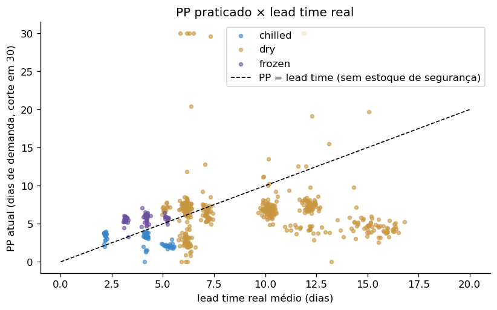

# CD Multitemperatura — Simulação e Otimização

🇺🇸 [English version](README.md)

Projeto de portfólio em supply chain: um **gêmeo digital** simplificado de um grande centro de distribuição multitemperatura (seco, resfriado e congelado) de bens de consumo. Gera 24 meses de operação simulada, diagnostica problemas operacionais com dados e propõe melhorias com ganho medido.

> **Aviso:** a *Sapucaí Distribution Center (SDC)* é uma empresa **fictícia**. Todos os dados são **sintéticos** (gerados por código) e os parâmetros são estimativas de ordem de grandeza. Veja [`docs/assumptions.md`](docs/assumptions.md). Qualquer semelhança com empresas reais é coincidência.

## O caso de negócio

A SDC atende ~1.500 lojas (B2B) e clientes de e-commerce a partir de um galpão de ~25.000 m², com 18.144 posições de palete, ~6.000 SKUs e 24 docas. As restrições reais deixam o problema difícil: FEFO e controle de validade, rastreabilidade de lote e recall, limite de exposição na doca (cadeia do frio), separação de palete/caixa/unidade e forte sazonalidade.

## Layout do galpão


Detalhes: [layout e endereçamento](docs/layout.md) · [fluxos de processo](docs/processes.md)

## Como rodar

```bash
pip install -r requirements.txt
python src/generate_data.py          # escala de 10%, ~30 s -> data/raw/ (Parquet)
python src/validate_data.py          # integridade + conservação de estoque + resumo de indicadores
python src/export_legacy.py          # opcional: CSVs "sujos" de sistema legado em data/legacy/ para treino de limpeza
python src/build_db.py               # Fase 3: carrega data/raw em um modelo estrela SQLite (data/sdc.db) e confere contagens
python src/run_kpis.py               # Fase 3: roda as consultas de KPI (fill rate, OTIF, dock-to-stock, perdas, giro...)
python notebooks/build_notebooks.py  # Fase 4: executa os notebooks de análise (04a-04e) -> reports/phase4/
python src/export_powerbi.py         # Fase 4: tabelas do painel -> powerbi/data/ (ver powerbi/README.md)
# Fases 5-6 rodam dentro dos notebooks (05a/05b slotting, 06a/06b simulação ~30 min)
```

Use `--scale 1.0` para o CD em tamanho completo (bem maior e mais lento). Mesma semente + mesma escala = dados idênticos.
Os dados têm problemas operacionais realistas que as próximas fases precisam **encontrar com dados**.
O gerador é aberto, então o gabarito é tecnicamente descobrível: para o exercício valer, analise os dados primeiro e leia o gerador depois.

## Roteiro

| Fase | Entrega | Status |
|---|---|---|
| 0. Fundação | Repositório, estrutura, premissas documentadas | Concluída |
| 1. Layout e processos | Zonas, endereçamento, fluxos | Concluída |
| 2. Gerador de dados | 24 meses de operação sintética com problemas ocultos, [modelo de dados](docs/data_model.md), exportação suja estilo sistema legado | Concluída |
| 3. Banco de dados | Modelo estrela em SQLite ([`sql/01_schema.sql`](sql/01_schema.sql)) e consultas de indicadores ([`sql/02_kpis.sql`](sql/02_kpis.sql)) | Concluída |
| 4. Diagnóstico e estoque | Qualidade dos dados, investigação de KPIs, ABC/XYZ, previsão, estoque de segurança e ponto de pedido, vencimento/FEFO, [modelo do dashboard v1](powerbi/README.md) | Concluída |
| 5. Slotting | Faces de picking (PuLP + HiGHS × regra COI), política de reabastecimento, plano de transição — [resumo](reports/phase5_summary.md) | Concluída |
| 6. Simulação | Modelo SimPy de recebimento e separação noturna, validado com os caminhões reais e calibrado pela fila de pedidos; cenários de pico, frota, docas, agendamento e slotting — [resumo](reports/phase6_summary.md) | Concluída |
| 7. Picking e mão de obra | Separação em lote no e-commerce, roteirização na planta cheia, quadro de 12 meses por turno — [resumo](reports/phase7_summary.md) | Concluída |
| 8. Custos e cenários | Custeio por atividade, custo de servir, carteira de investimentos (VPL/payback), decisão S01 da estrutura das câmaras — [resumo](reports/phase8_summary.md) | Concluída |
| 9. Qualidade | Pareto das perdas, Ishikawa 6M, FMEA do recebimento frio, rastreio de recall, inventário cíclico ABC, [POPs](docs/sops/) — [resumo](reports/phase9_summary.md) | Concluída |
| 10. Programa de redução de custos | Linha de base de custo do galpão (custo por pedido/linha/palete, cost-to-serve), pipeline de economias das fases 4–9 com investimento e payback | Planejada |
| 11. Fechamento | Relatório executivo e dashboard final | Planejada |

## Resultados da Fase 4 (diagnóstico)

Relatório completo: [reports/phase4_summary.md](reports/phase4_summary.md) · notebooks `04a`–`04e` em [notebooks/](notebooks/).

- **OTIF de 52%, puxado pela ruptura e não pelo transporte:** o pedido B2B (~32 linhas) sai completo
  só 23% das vezes. A causa é o ponto de pedido fixo em dias por zona, que ignora o lead time de cada
  fornecedor. A ruptura chega a 15% onde o PP fica abaixo do lead time. Com estoque de segurança por
  SKU (nível de serviço 98/95/90% pela curva ABC), o capital em estoque sobe cerca de **+2%** (estimativa).
- **A perda por vencimento nasce no recebimento:** lotes aceitos abaixo da regra de 70% de vida útil
  (dois fornecedores) geram **72% das unidades vencidas**. O FEFO é violado em 19% dos SKU-dias.
- **Cadeia do frio:** um evento de duas semanas em jan/2026 causou 1/3 da perda por frio dos 24 meses
  (a exposição na doca dobrou). De forma crônica, 61% dos paletes congelados passam do limite de 15 min na doca.
- **Falhas de processo:** 57% das promoções não chegam ao planejamento (fill rate de 86% contra 97%) e
  71% dos caminhões chegam entre 7h e 12h. O erro de putaway é 4× maior no turno 2 e 6–7× maior em um operador.
  No pico de dezembro, a fila antes da liberação do pedido vai de 0,3 para 1,3 dia.



## Resultados da Fase 5 (slotting)

As faces de picking estavam na ordem do código do SKU: 71 dos 122 itens da curva A não tinham face.
Um modelo de designação em PuLP/HiGHS reduz o custo estimado de separação + reabastecimento em
**~8%** (payback de cerca de uma semana), uns 20% a mais que a regra simples "o mais visitado na face
mais próxima". Os melhores candidatos à face são os SKUs com muitas visitas por palete, não os mais
vendidos. Manter a face abastecida dá quase o mesmo ganho de novo.
Detalhes em [reports/phase5_summary.md](reports/phase5_summary.md). Os ganhos ficam registrados em
[reports/savings_register.csv](reports/savings_register.csv) para o programa de custos da Fase 10.

## Resultados da Fase 6 (simulação)

Um modelo SimPy alimentado com os caminhões e pedidos reais reproduz o dock-to-stock e a fila mensal
de pedidos observados. O risco do pico é a capacidade de separação: o Natal +40% sem preparação gera
fila de 8 dias. O slotting da Fase 5 leva a separação de dezembro de 17% para 77% dos pedidos na noite
prevista, sem contratar ninguém, e evita ≈ R$ 287 mil em temporários por temporada. O agendamento
distribuído reduz a espera do caminhão frio sem custo. A exposição de frio na doca é problema de
processo, não de falta de empilhadeira. Detalhes em [reports/phase6_summary.md](reports/phase6_summary.md).

## Resultados da Fase 7 (separação e mão de obra)

No e-commerce, o separador passa ~70% do tempo andando. Com carrinho de 8 pedidos, as linhas por hora
triplicam (35 → 104). Na planta em escala cheia, o slotting por popularidade encurta a rota em ~43%,
bem mais do que a regra de percurso (~11%). O plano de quadro para 12 meses (fixo + temporários no
pico) custa R$ 15,5 mi/ano, contra R$ 18,4 mi com quadro fixo dimensionado para o pico; com os métodos
melhorados, cai para R$ 13,0 mi. Detalhes em [reports/phase7_summary.md](reports/phase7_summary.md).

## Resultados da Fase 8 (custos e cenários)

O custeio por atividade estima o custo do CD em ≈ R$ 97 mi/ano (3,5% da receita movimentada). Perdas de
produto são ~63% desse valor, quase tudo da cadeia do frio. O e-commerce custa 5× mais por unidade que o
B2B. Na carteira de investimentos, o kit de doca fria com POP lidera (VPL de 5 anos ≈ R$ 47 mi). Duas
docas frias extras, os carrinhos do e-commerce, o agendamento e o slotting se pagam em meses. No cenário
S01, o drive-in não serve para o perfil de SKUs e lotes (só ~28% de cada pista é usável respeitando o
FEFO). A decisão real é entre seletivo + ampliação da câmara e estantes móveis, e depende de orçamentos.
Detalhes em [reports/phase8_summary.md](reports/phase8_summary.md).

## Resultados da Fase 9 (qualidade)

Três causas da cadeia do frio concentram ~80% das perdas de produto. A FMEA do recebimento refrigerado,
com a ocorrência tirada das taxas medidas, coloca em primeiro o palete que passa do tempo de doca
(RPN 648), seguido da falha de equipamento da câmara e da carga congelada aceita acima de −18 °C. Os dois
recalls são rastreados de ponta a ponta com balanço de massa de 100% e apontam o mesmo fornecedor e o
mesmo SKU. O inventário cíclico conta mais os itens C que os A; um programa ABC por risco corrige isso.
Quatro POPs transformam os achados em padrão de trabalho. Detalhes em
[reports/phase9_summary.md](reports/phase9_summary.md).

## Estrutura do repositório

```
├── docs/                  # premissas, layout, processos, decisões
├── config/parameters.yaml # parâmetros do CD (fonte única da verdade)
├── src/                   # gerador de dados, simulação, análises
├── sql/                   # schema e consultas de indicadores
├── notebooks/             # análises passo a passo
├── powerbi/               # dashboard (.pbix)
├── reports/               # relatórios e gráficos finais
└── data/                  # gerado localmente, fora do Git
```

## Como começar

```bash
python -m venv .venv
# Windows: .venv\Scripts\activate   |   Linux/macOS: source .venv/bin/activate
pip install -r requirements.txt
python src/check_setup.py
```

## Tecnologias

Python (pandas, NumPy, statsmodels, SimPy, PuLP) · SQL (SQLite) · Power BI (DAX) · Git

## Autor

**John Wesley da Silva** — Engenheiro de Produção (pós-graduado em Engenharia de Processos), com background em processos e qualidade, focado em supply chain e análise de dados.
[LinkedIn](https://www.linkedin.com/in/john-wesley-da-silva/)
