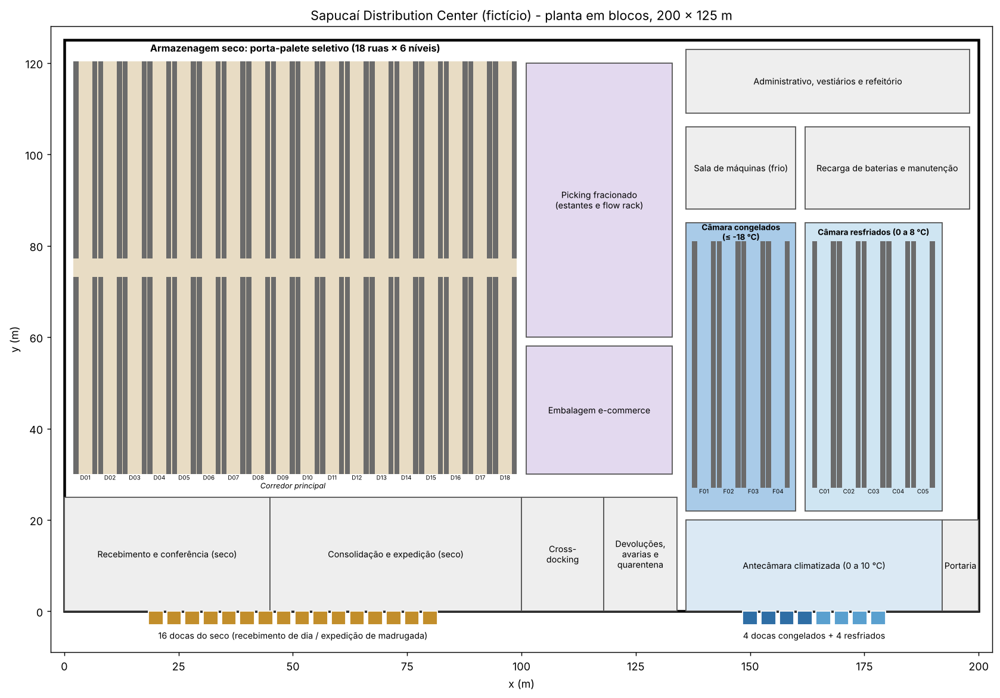

# Fase 1 — Layout e endereçamento

> **EN summary:** 200 × 125 m (25,000 m²) facility with selective pallet racking for PBR pallets (1.00 × 1.20 m), 6 levels, 3.0 m reach-truck aisles. Capacity derived from geometry: **18,144 pallet positions** (dry 13,824 · chilled 2,400 · frozen 1,920), of which 3,024 are ground-level pick faces. U-flow with shared dry docks (receiving by day, shipping at night) and a temperature-controlled antechamber for the cold chain. Generated by `src/layout.py` from `config/layout.yaml`.

## Capacidade (derivada da geometria)
| Zona | Ruas | Prédios por rua | Níveis | Picking (nível 1) | Pulmão (níveis 2 a 6) | Total |
|---|---|---|---|---|---|---|
| Seco (D) | 18 | 64 (2 seções × 16 × 2 lados) | 6 | 2.304 | 11.520 | 13.824 |
| Resfriado (C) | 5 | 40 | 6 | 400 | 2.000 | 2.400 |
| Congelado (F) | 4 | 40 | 6 | 320 | 1.600 | 1.920 |
| **Total** | | | | **3.024** | **15.120** | **18.144** |

A estimativa da Fase 0 era ~18.500; a calibração pela geometria deu 18.144 (−2%).

## Uso da área (25.000 m²)
| Uso | m² |
|---|---|
| Bloco de porta-palete do seco | 8.769 |
| Câmaras frias, antecâmara e áreas de apoio | 12.796 |
| Circulação e folgas | 3.435 (14%) |

## Endereçamento
Formato **ZONA-RUA-PRÉDIO-NÍVEL-APARTAMENTO**, ex.: `D-05-023-3-1`.
- **Zona:** D (seco), C (resfriado), F (congelado).
- **Rua:** corredor, numerado da esquerda para a direita.
- **Prédio:** ímpares no lado esquerdo da rua e pares no direito, começando pelo lado das docas (como numeração de casas). Assim o operador sabe o lado só pelo número.
- **Nível:** 1 = chão (picking); 2 a 6 = pulmão.
- **Apartamento:** 1 ou 2 (dois paletes por nível).

Cada endereço tem coordenadas (x, y, z) do ponto de parada no centro da rua. Elas serão usadas para calcular distâncias de picking (Fase 5) e tempos de deslocamento na simulação (Fase 6).

## Decisões de projeto
| Decisão | Escolha | Por quê | Alternativa descartada |
|---|---|---|---|
| Estrutura de armazenagem | Porta-palete seletivo em todas as zonas | Acesso direto a qualquer palete, obrigatório para FEFO e bloqueio de lote | Drive-in nas câmaras: +30 a 40% de densidade e menos energia, mas fere o FEFO. Será avaliado como cenário na Fase 8 (custos) |
| Equipamento | Empilhadeira retrátil, corredor de 3,0 m | Alcança o 6º nível (~9 m) com corredor estreito | Contrabalançada: exige ~3,5 m de corredor (perderia ~2 ruas) |
| Fluxo | Em U, docas do seco compartilhadas | Recebimento de dia e expedição de madrugada não disputam a doca; menos docas ociosas | Fluxo em I (docas em faces opostas): mais segregado, mas exigiria ~2× docas |
| Picking | Nível 1 do porta-palete para caixas; área de estantes e flow rack para unidades (e-commerce) | Separa o picking por caixa (B2B) do fracionado (B2C) | Picking de unidades no porta-palete: muitos deslocamentos para pedidos de 4 linhas |
| Cadeia do frio | Antecâmara climatizada (0 a 10 °C) entre docas e câmaras | Evita quebra térmica na carga/descarga e condensação | Doca direta na câmara: perda de frio a cada abertura |

## Restrições conhecidas (problemas para as próximas fases)
- **Picking < SKUs:** o seco tem 2.304 faces de picking para ~4.500 SKUs; nem todo SKU cabe no nível 1. Decidir quem fica no picking, no fracionado ou só no pulmão é o problema de **slotting** (Fase 5).
- **Câmaras pequenas para a sazonalidade:** resfriado e congelado têm folga menor; a Páscoa e o verão (sorvete) devem pressionar a ocupação.
- **Coordenadas simplificadas:** a distância será calculada pela malha de corredores (distância retilínea), sem modelar o giro da empilhadeira.
