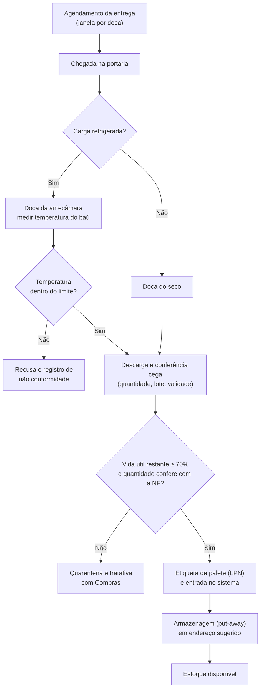
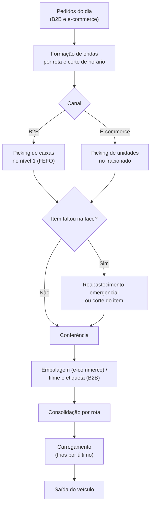
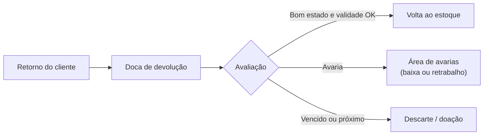
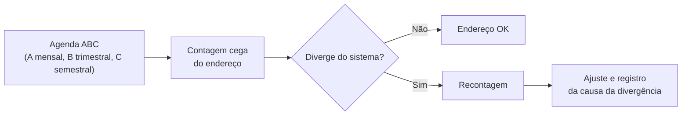
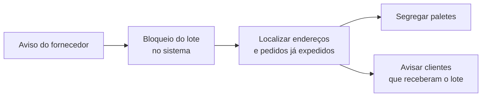

# Fase 1 — Processos

> **EN summary:** Core warehouse processes mapped as flowcharts: inbound (receiving with cold-chain and shelf-life checks), outbound (wave picking to loading), replenishment (reserve → pick face), returns, cycle counting and lot recall. Each process lists the KPIs it feeds.

## Janelas de operação
| Turno | Horário | Atividade principal |
|---|---|---|
| 1º | 06h às 14h | Recebimento, armazenagem, inventário cíclico |
| 2º | 14h às 22h | Reabastecimento do picking, separação (ondas B2B e e-commerce) |
| 3º | 22h às 06h | Conferência, carregamento e expedição |

## 1. Recebimento (inbound)

Regra da cadeia do frio: da abertura do baú até a câmara, no máximo 30 min (resfriado) e 15 min (congelado).
**Indicadores:** dock-to-stock, % de recusas por fornecedor, aderência ao agendamento.

## 2. Separação e expedição (outbound)

**Indicadores:** fill rate, OTIF, lead time do pedido, produtividade (linhas/h), erros de separação.

## 3. Reabastecimento (pulmão → picking)

**Indicadores:** reabastecimentos emergenciais, ruptura na face.

## 4. Devolução (logística reversa)

**Indicadores:** % de devolução por motivo, perdas por avaria e vencimento.

## 5. Inventário cíclico

**Indicadores:** acuracidade de inventário (endereço e quantidade), causas de divergência.

## 6. Recall (bloqueio de lote)

**Indicadores:** tempo para localizar 100% do lote.
