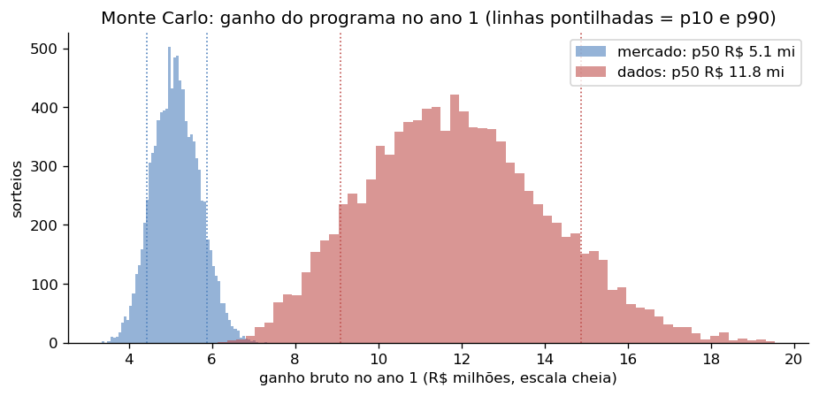
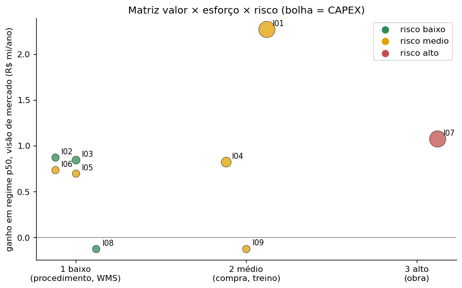

# Fase 10: Programa de redução de custos

> *EN summary: the DC costs R$ 96.7M/yr as in the data, or R$ 54.3M/yr if cold-chain losses are brought
> down to a market-like 1% of cold revenue. After de-duplicating the Phase 5–9 savings register (raw sum
> R$ 23.3M, which mixed scales and counted slotting four times), the program is worth R$ 7.1M/yr at run-rate
> (p50, market view; p10–p90 R$ 6.2–8.1M) and R$ 5.1M in year 1, for R$ 1.7M of capex that pays back in
> month 4. The cold-dock kit drives most of the uncertainty. Cost-to-serve: small e-commerce orders
> (< R$ 25, 1 in 4) barely cover picking and packing; 26 slow-moving or discontinued C items destroy value.*

Notebooks: [`10a`](../notebooks/10a_cost_baseline_pipeline.ipynb) (linha de base e consolidação),
[`10b`](../notebooks/10b_monte_carlo_roadmap.ipynb) (Monte Carlo, priorização, plano e KPIs) e
[`10c`](../notebooks/10c_cost_to_serve_client_sku.ipynb) (custo de servir por cliente e SKU) · tabelas em
[`phase10/`](phase10/) · premissas em [`config/cost_program.yaml`](../config/cost_program.yaml).
Escala cheia, ano-base nov/2025–out/2026, valores estimados. Decisões do John: perdas de frio em duas
visões e horizonte de 12 meses.

## 1. Linha de base: duas visões das perdas de frio

As baixas por frio dos dados (R$ 56,0 mi/ano: 2,4% da receita do resfriado e 8,1% do congelado) estão muito
acima de uma operação madura. A visão de mercado rebaixa essa perda a 1% da receita da zona. É uma
premissa estimada, sem fonte específica, e fica no config. A priorização usa a visão de mercado, que é
a conservadora.

| Indicador | Como nos dados | Ajustada ao mercado |
|---|---|---|
| Perda por frio (R$ mi/ano) | 56,0 | 13,6 |
| Custo total do CD (R$ mi/ano) | 96,7 | 54,3 |
| Custo em % da receita movimentada | 3,5% | 2,0% |
| Custo por pedido B2B | R$ 499 | R$ 272 |
| Custo por unidade B2B | R$ 0,36 | R$ 0,20 |
| Custo por pedido e-commerce | R$ 8,3 | R$ 7,8 |
| Custo por unidade e-commerce | R$ 1,87 | R$ 1,75 |

Lacuna: o produto devolvido e descartado (R$ ~9 mi/ano no Pareto da Fase 9) não está no custeio da Fase 8.
Ele fica fora da base e é citado como exposição.

## 2. Consolidação: por que o total não é a soma do registro

A soma bruta do [`savings_register.csv`](savings_register.csv) dá R$ 23,3 mi/ano, mas não serve como
meta. Ela mistura escala 10% com escala cheia, conta o slotting em quatro fases e inclui uma evitação de
custo que não reduz a base: o quadro fixo com temporários, R$ 2,9 mi frente a um quadro dimensionado para o pico.
Cada linha recebeu um destino rastreável em
[`10a_reconciliacao_registro.csv`](phase10/10a_reconciliacao_registro.csv). Slotting e carrinho foram
recalculados juntos: a sobreposição deu só R$ 26 mil, descontados do carrinho.

| # | Iniciativa | Ganho em regime p50, mercado (R$ mil/ano) | Visão dos dados (R$ mil/ano) | CAPEX (R$ mil) | Onda |
|---|---|---|---|---|---|
| I01 | Kit de doca fria + POP-01 (8 docas) | 2.271 | 10.709 | 760 | 1 |
| I07 | +1 doca fria por câmara (após o agendamento) | 1.074 | 1.074 | 760 | 3 |
| I02 | Agendamento distribuído de docas | 874 | 874 | 0 | 1 |
| I03 | Slotting otimizado das faces | 848 | 848 | 25 | 1 |
| I04 | Carrinho multi-volume no e-commerce | 825 | 825 | 149 | 2 |
| I06 | Trava de vida útil de 70% no WMS + scorecard F004/F014 | 736 | 735 | 0 | 1 |
| I05 | Reabastecimento da face por mínimo | 695 | 695 | 0 | 1 |
| I08 | Inventário cíclico por ABC (custo) | −126 | −126 | 0 | 1 |
| I09 | ES/PP por SKU (custo de capital; o ganho é serviço) | −123 | −123 | 0 | 2 |

O p50 por iniciativa já desconta a captura esperada pelo risco de implantação. Por isso fica abaixo do
valor-base do 10a.

## 3. Quanto o programa rende (Monte Carlo, 10 mil sorteios)

| R$ mi | p10 | p50 | p90 |
|---|---|---|---|
| Regime anual, visão de mercado | 6,2 | 7,1 | 8,1 |
| Ano 1, visão de mercado | 4,4 | 5,1 | 5,9 |
| Regime anual, visão dos dados | 12,2 | 15,5 | 19,3 |
| Ano 1, visão dos dados | 9,1 | 11,8 | 14,9 |

- CAPEX total de R$ 1,7 mi. O ganho do ano 1 supera o CAPEX em 100% dos sorteios, nas duas visões.
  Ganho líquido do ano 1 (p50): R$ 3,4 mi no mercado e R$ 10,1 mi nos dados.
- Na curva mês a mês (p50, mercado), o saldo acumulado fica positivo no mês 4 e fecha o ano em
  +R$ 3,7 mi.
- **O kit de doca fria decide a incerteza** (correlação de postos de 0,81 com o total). Antes de prometer
  o número, a premissa a validar é a fração da perda crônica que o kit evita (20–60%), com um piloto em 2 docas.

## 4. Plano em 12 meses

| Onda | Iniciativas | Por quê |
|---|---|---|
| 1 · 0–3 meses | I02 agendamento · I03 slotting · I01 kit de doca fria + POP-01 · I06 trava de 70% · I05 reabastecimento por mínimo · I08 inventário cíclico | Procedimento e configuração de WMS, CAPEX baixo; o kit é o maior valor nas duas visões |
| 2 · 3–6 meses | I04 carrinho do e-commerce · I09 ES/PP por SKU | Dependem de TI e de treinamento |
| 3 · 6–12 meses | I07 +1 doca fria por câmara | Obra de maior risco, só se a espera da carreta fria continuar acima da meta após 3 meses de agendamento |

Habilitadoras sem valor no total: telemetria e preventiva das câmaras (o evento de jan/2026 custou
R$ ~20,7 mi), 8D com o Fornecedor 010 (recalls), FEFO dirigido (devoluções por validade curta), POP-02
no turno 2, liquidação de descontinuados e calendário de promoções com aceite do PCP.

## 5. KPIs de acompanhamento

| Iniciativa | KPI | Linha de base | Meta proposta | Frequência | Dono |
|---|---|---|---|---|---|
| I01 | % paletes resfriados acima de 30 min na doca | 27% | ≤ 5% | diária | Recebimento |
| I01 | % paletes congelados acima de 15 min na doca | 63% | ≤ 5% | diária | Recebimento |
| I01 | Perda por frio (% da receita do frio) | 4,1% | ≤ 1% | mensal | Qualidade |
| I02/I07 | Espera p90 da carreta resfriada no pátio | 348 min | ≤ 240 min | semanal | Recebimento |
| I03/I05 | % visitas atendidas na face de picking | 26% | ≥ 85% | semanal | Armazenagem |
| I04 | Linhas por hora no e-commerce | 35 | ≥ 90 | diária | Operações |
| I06 | % paletes aceitos com < 70% de vida útil | 6,0% | 0% | diária | Recebimento |
| I08 | Acuracidade de inventário | 95,8% | ≥ 98,5% | mensal | Inventário |
| I09 | Fill rate em unidades | 92,4% | ≥ 97% | semanal | PCP |
| Programa | Custo por pedido B2B | R$ 499 | −10% em 12 meses | mensal | Controladoria |
| Programa | Custo por unidade e-commerce | R$ 1,87 | −25% em 12 meses | mensal | Controladoria |

## 6. Custo de servir por cliente e SKU (margem − custo do CD)

| Achado | Evidência |
|---|---|
| Todo cliente paga o custo do CD | A margem do cadastro é ~30% da receita (preço = 1,2–1,6 × custo); o custo do CD é ~3,5% |
| Pedido pequeno de e-commerce empata | Pedidos < R$ 25 são 26% do total; margem média de R$ 4,32 contra custo de R$ 4,29; 49% deles dão prejuízo |
| E-commerce custa ~17% da receita do cliente; a loja, ~3,4% | Faixa de 11% a 28% entre clientes de e-commerce |
| 26 SKUs (todos curva C) destroem valor | −R$ ~0,6 mi/ano: descontinuados parados e itens de giro baixo do seco |

**Aviso de qualidade:** as lojas B2B dos dados são quase idênticas no custo de servir (3,1–3,6%), porque o
gerador não diferencia o perfil da loja. Com dados reais, é nessa análise que aparecem os clientes caros.
Frete, comercial e impostos estão fora; com eles, a margem cai e a conclusão pode mudar.

| O quê | Por quê | Quem | Quando | Como | Quanto |
|---|---|---|---|---|---|
| Pedido mínimo ou frete por faixa no e-commerce | Pedidos < R$ 25 não pagam a operação | Comercial + Controladoria | Onda 2 | Teste em uma região | Zero (política) |
| Liquidar descontinuados e rever o mix de giro baixo | 26 SKUs C com contribuição negativa | Compras + Comercial | Onda 1 e revisão trimestral | `10c_rentabilidade_sku.csv` | Zero |
| Custo de servir no painel mensal | Acompanhar o programa por cliente e SKU | Controladoria | Onda 1 | Power BI com as tabelas da Fase 10 | Zero |

**Conferência:** a linha de base fecha com o custeio da Fase 8 (R$ 96,66 mi), as perdas de frio fecham com o
Pareto da Fase 9 (R$ 56,0 mi) e o custo de servir por linha + SKUs sem venda fecha com R$ 96,66 mi.
